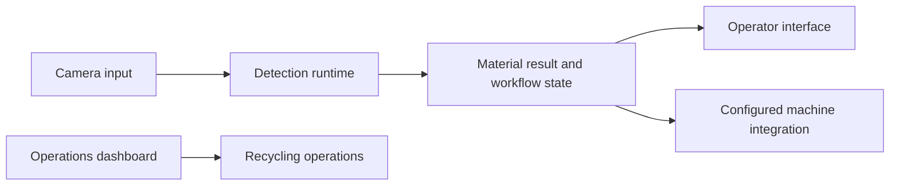

# GreenGuard26

**Computer vision and software workflows for a recycling kiosk.**

GreenGuard26 connects camera-based material detection, machine workflow boundaries, and an operations dashboard. It is part of a recycling ecosystem with the separate GreenPoint rewards application.

## Project at a glance

| Area | Implementation |
| --- | --- |
| Detection | Python inference code and packaged ONNX models |
| Operator tools | Windows diagnostic, candidate-comparison, and full-workflow launchers |
| Edge runtime | A separate Jetson runtime bundle |
| Dashboard | Frontend and backend under `Dashboard/` |
| Status | Hardware-oriented project with diagnostic and machine-connected modes |

## My contributions

I worked on detection runtime organization, training pipeline corrections, validation tools, and the dashboard. Representative changes:

- [Separate PC and Jetson runtime bundles](https://github.com/khanhtuongnakitomo/GreenGuard26/pull/23).
- [Standalone Model 1-B tester](https://github.com/khanhtuongnakitomo/GreenGuard26/commit/e52b1d4413f187a015ac1cd10b0f47b88e966496).
- [Dashboard updates](https://github.com/khanhtuongnakitomo/GreenGuard26/pull/13).

## How the pieces fit

Diagnostic and candidate launchers remain separate from machine-connected operation. Candidate packages are explicitly labelled and do not replace the active model automatically. Hardware acceptance depends on the configured camera, model package, and device integration; it is separate from software-only checks.

## Explore and run

Start with the [documentation map](DOCUMENTATION.md), then choose the component you want to inspect:

| Component | Guide |
| --- | --- |
| Windows launchers and setup | [Detection quick start](Trash-detection/README.md) |
| PC runtime | [PC demo](Trash-detection/pc-demo/README.md) |
| Jetson runtime | [Jetson bundle](Trash-detection/jetson-runtime/README.md) |
| Model training | [Training guide](Trash-detection/training/README.md) |
| Validation | [Validation guide](Trash-detection/validation/README.md) |
| Dashboard | [Frontend](Dashboard/frontend/) and [backend](Dashboard/backend/) source |

Model files, hardware settings, and runtime contracts are documented with the relevant component. Use those guides for setup rather than treating the repository as a single generic web app.

## Portfolio

[Tuong Huynh's project portfolio](https://github.com/khanhtuongnakitomo)
